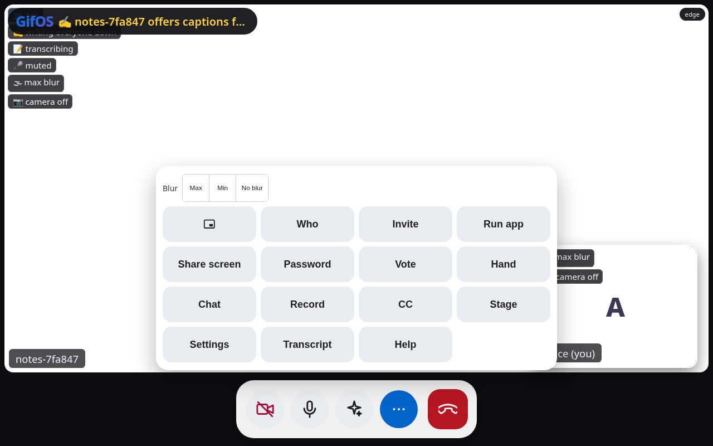
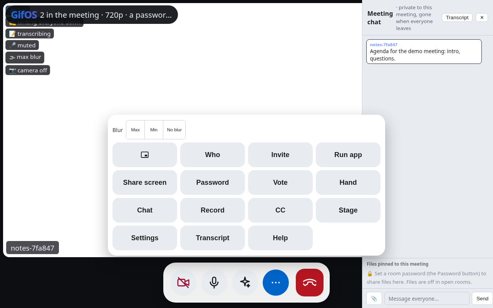
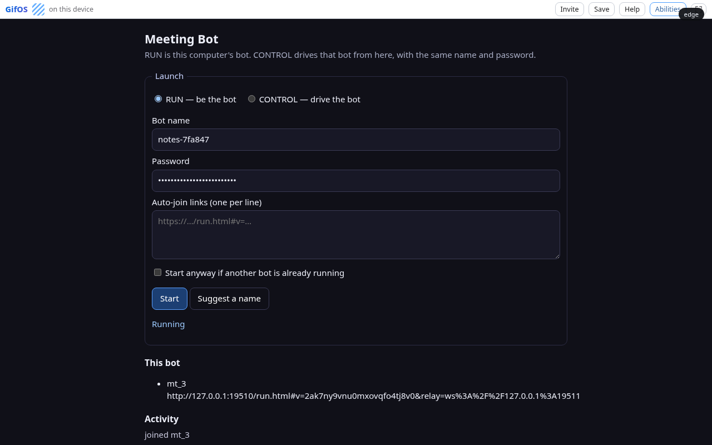
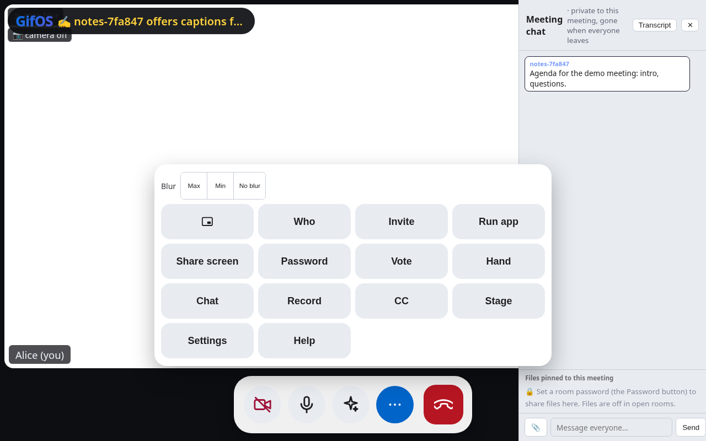

# Proof: gifos-mcp end to end

These runs are from 2026-10-15 at commit `e17a899`, on Linux x64 with Node v22.23.1 and Playwright 1.61.1
(Chromium 149, headless). Each one was run with `nice -n 10`.

## What ran

| Suite | GifOS site | Meeting Bot | Runs | Result |
|---|---|---|---|---|
| `npm test` (unit: config, all 10 tools with a fake bot, `--http` transport) | none | none | 1 | 18 pass, 0 fail, 0 skipped |
| `npm run test:e2e`, real Whisper speech-to-text | `gifos-app` `release/0.9.23` (`4c9fef4`) | packed from `gifos-apps-source` `meet-bot` (`2c2b080`) | 5 | 17/17 checks each, 47 to 54 s per run |
| `npm run test:e2e`, real Whisper speech-to-text | `gifos-app` `meet-bot` (`3217209`) | that site's own store listing | 2 | 17/17 checks each, 49 and 73 s |
| `npm run test:e2e`, synthetic speech-to-text | `release/0.9.23` (`4c9fef4`) | packed from `2c2b080` | 2 | 17/17 checks each, about 17 s per run |
| `npx -y github:nwcnwc/gifos-mcp#e17a899` over stdio: list tools, `create_meeting` | gifos.app | none | 1 | OK |

## Setup

- GifOS was served on `127.0.0.1:19510`. A local GifOS 0.9.23 relay ran on `127.0.0.1:19511`.
- `gifos-mcp` installed Meeting Bot through the GifOS store page, the same way a person clicks Install. It drove
  the bot through its local control API (`window.MeetingBot`, contract version 1).
- Speech-to-text: `gifos-mcp` installed the store's Offline Captions (Whisper) app into Providers and assigned it
  to speech-to-text. The Whisper model came from its pinned download.
- "Alice" was a second headless Chromium whose fake microphone played an 11-second public-domain speech
  recording. She turned her mic on after joining.

## The flow each e2e run checks

`create_meeting` → `start_meeting` (install from store, start RUN, join, transcribe) → `status` → Alice joins and
sees the 🤖 bot badge and the 📝 transcribing chip → `get_transcript` contains Alice's words → `share_content`
shows in Alice's chat → `mute` removes the chip → `unmute` → `list_meetings` → `end_meeting` → the bot tile is
gone → `get_transcript` still returns the saved text.

The transcript from Whisper run 1, as `get_transcript` returned it:

```
Alice: fellow America.
Alice: As not!
Alice: what your country can do for you, ask what you can do for your country.
```

## Screenshots (Whisper run 1)

| Alice sees the bot | Shared text in Alice's chat |
|---|---|
|  |  |

| The bot's Meeting Bot tab (RUN) | After `end_meeting` |
|---|---|
|  |  |
