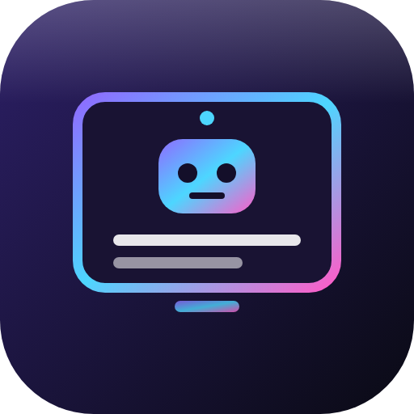

<p align="center"></p>

# gifos-mcp: GifOS Meet connector for Grok Bot

`gifos-mcp` is an [MCP](https://modelcontextprotocol.io) server that lets Grok Bot (or any MCP client) create
[GifOS](https://gifos.app) meetings, put a note-taking bot in them, and read back the transcript.

It runs **on your own computer**. It starts a headless Chromium running GifOS, installs the **Meeting Bot** app
from the GifOS app store, and drives it. Meetings stay peer to peer between the people in them. Transcripts stay
on your computer. No GifOS account or API key is involved.

> **Requires GifOS 0.9.23 or newer**, the release that ships the Meeting Bot store app. Until it is live on
> gifos.app, point `GIFOS_URL` at a GifOS 0.9.23 site (see [Testing](#testing-instructions-for-marketplace-reviewers)).

## How it works

```
Grok Bot ──MCP (stdio)──▶ gifos-mcp ──▶ headless Chromium (one profile in ~/.gifos-mcp)
                                         └─ GifOS desktop
                                              ├─ Meeting Bot, running as the bot (RUN mode)
                                              │    driven through its local control API, window.MeetingBot v1
                                              └─ Offline Captions (Whisper), the speech-to-text provider
```

- `create_meeting` only mints a meeting link. Nothing joins yet.
- `start_meeting` or `join_meeting` sends the bot into the meeting. Everyone in the meeting sees it as a tile
  labelled **🤖 bot** with a **📝 transcribing** chip. The bot has no camera. This server does not play audio.
- Speech is turned into text on your computer by the Offline Captions (Whisper) app from the GifOS store. The bot
  writes down each participant who is unmuted, credited by name. It never writes down its own machine's
  microphone.
- `get_transcript` reads the transcript straight from the bot. Meeting Bot's
  [control contract](https://github.com/nwcnwc/gifos-apps-source/blob/meet-bot/meeting-bot/CONTROL.md) (version 1)
  is the only interface this server relies on. The voice handoff is written up in
  [docs/MEETBOT-BRIDGE.md](docs/MEETBOT-BRIDGE.md).

**The only AI in the meeting is Meet Bot.** This server launches the signed Meeting Bot app from the GifOS store
in a headless browser and passes commands through `window.MeetingBot`. It does not join as a second participant
and it does not call a model. Meet Bot has two switches: respond to commands (on or off) and conversation voice
(`none`, Grok Voice, or a local LLM with Kokoro). A local LLM is any OpenAI-compatible endpoint, with your own
key, or a provider app. The suggested default is xAI Grok (`grok-4.20-0309-non-reasoning`). On startup this
server installs the speech providers and writes the endpoint into Settings → AI models, the same way you would.
`set_voice` then names those providers. It does not send the URL or the key. Until the app accepts the setting,
the tool reports the gap and this server does not imitate speech.

Your own assistant tails the live transcript (`gifos://meeting/{id}/transcript`, or `tail_transcript`) and can
cut in with `say`, which Meet Bot speaks. After the meeting, that assistant does the notes, mail, and calendar
work.

**Grok Bot does the timing and the invites.** A Grok Bot routine calls `start_meeting` at meeting time. Invites
go out through your own email or calendar connector in Grok Bot, and you approve each send. This server never
sends email or calendar invites.

**The server must be running at meeting time.** If the machine is asleep or the server is stopped when the
routine fires, the bot is not in the meeting. Run it on a machine that is always on. The always-on box that
already runs Grok Bot is the best place.

## Install

You need **Node.js 20 or newer**. The first start downloads Chromium for Playwright (about 150 MB), and the
first transcription downloads the Whisper model (about 77 MB).

Run it straight from GitHub:

```sh
npx -y github:nwcnwc/gifos-mcp
```

`npx gifos-mcp` works the same once the package is published to npm.

Or from a clone:

```sh
git clone https://github.com/nwcnwc/gifos-mcp.git
cd gifos-mcp
npm install
npx playwright install chromium
node bin/gifos-mcp.js            # stdio
node bin/gifos-mcp.js --http     # or streamable HTTP on http://127.0.0.1:19520/mcp
```

If Chromium is missing, the server runs `playwright install chromium` by itself on first start. Set
`GIFOS_MCP_NO_INSTALL=1` to turn that off.

## Grok Bot setup

Add a local (stdio) MCP server in Grok Bot's MCP / connector settings. The configuration is the standard
`mcpServers` JSON:

```json
{
  "mcpServers": {
    "gifos-meet": {
      "type": "stdio",
      "command": "npx",
      "args": ["-y", "github:nwcnwc/gifos-mcp"],
      "env": {
        "GIFOS_URL": "https://gifos.app",
        "GIFOS_LLM_KEY": "your-key"
      }
    }
  }
}
```

From a clone, use `"command": "node"` and `"args": ["/path/to/gifos-mcp/bin/gifos-mcp.js"]`.

The server warms up in the background as soon as Grok Bot starts it, so the first `start_meeting` doesn't wait
for the browser. A cold start takes about 10 seconds, plus downloads on the very first run.

If your client can only reach MCP over HTTP, run `gifos-mcp --http [port]`. It listens on `127.0.0.1` only. Set
`GIFOS_MCP_HTTP_TOKEN` to require `Authorization: Bearer <token>`.

## Environment variables

| Variable | Default | What it does |
|---|---|---|
| `GIFOS_URL` | `https://gifos.app` | The GifOS site to use. It must be 0.9.23 or newer with Meeting Bot in its store. |
| `GIFOS_RELAY` | GifOS default | A custom relay (`wss://…`) for self-hosted GifOS. It is added to meeting links. |
| `GIFOS_BOT_NAME`, `GIFOS_BOT_PASSWORD` | generated | The Meeting Bot name and password. They derive the bot's secret admin meeting. The name is what participants see. If unset, a strong pair is generated once and kept in `GIFOS_MCP_HOME/bot.json` (mode 0600). |
| `GIFOS_STT_APP` | `offline-stt-whisper` | The store app that turns speech into text. `none` turns transcription off. |
| `GIFOS_MCP_HOME` | `~/.gifos-mcp` | The browser profile, the bot credential, and `meetings.json`. |
| `GIFOS_HEADLESS` | `1` | `0` shows the browser windows, which helps when debugging. |
| `GIFOS_CHROME` | Playwright's Chromium | Path to another Chromium or Chrome binary. |
| `GIFOS_TIMEOUT_MS` | `120000` | How long to wait for GifOS steps such as joining. |
| `GIFOS_MCP_HTTP_TOKEN` | none | A bearer token for `--http`. |
| `GIFOS_MCP_LAZY` | `0` | `1` starts the browser on the first tool call instead of at launch. |
| `GIFOS_MCP_DEBUG` | `0` | `1` logs the GifOS console to stderr and adds per-meeting caption state to `status`. |
| `GIFOS_MCP_SHOTS` | none | A folder for screenshots of the bot's screens (for debugging). |
| `GIFOS_LLM_KEY` | none | Your key for the text model. It is written into the GifOS computer's Settings → AI models (the `smartest` row), which is where you would type it. It is not logged, not put in a tool result, and not passed to `MeetingBot.setVoice`. Leave it unset and conversation voice stays off unless you set `GIFOS_CONVERSATION_VOICE` or `GIFOS_LLM_APP`. |
| `GIFOS_LLM_URL` | `https://api.x.ai/v1` when a key is set and `GIFOS_LLM_APP` is empty | OpenAI-compatible base URL, stored as the `smartest` endpoint in Settings. This server does not call it. |
| `GIFOS_LLM_MODEL` | `grok-4.20-0309-non-reasoning` on that host | Model name stored with that endpoint. Required when the URL is not xAI, conversation voice is `local`, and `GIFOS_LLM_APP` is empty. |
| `GIFOS_LLM_APP` | empty | A store provider app assigned to `smartest` instead of a URL. |
| `GIFOS_CONVERSATION_VOICE` | `local` when a key or URL is set, otherwise `none` | `none`, `grok` (Grok Voice), or `local` (the configured LLM, then Kokoro). Meet Bot owns the voice. |
| `GIFOS_RESPOND_TO_COMMAND` | on | `0` tells Meet Bot not to answer commands it hears. |
| `GIFOS_VOICE` | follows the settings above | `0` forces conversation voice `none`. Tailing the transcript still works. |
| `GIFOS_TRANSCRIPT_POLL_MS` | `500` | How often captions are copied from Meet Bot into the live transcript. |
| `GIFOS_TTS_ENGINE` | `kokoro` | `auto` and `kokoro` install the store app `offline-tts-kokoro` (voice `af_heart`) and assign it as text-to-speech, including on a fresh profile. `none` does not install it. This server does not run the speech engine. |
| `GIFOS_TTS_APP` | `offline-tts-kokoro` | Another store provider app to install and assign for speech. |
| `GIFOS_TTS_VOICE` | `af_heart` | Kokoro voice name, passed through with local voice. |
| `GIFOS_TTS_URL` | empty | HTTP speech stand-in, stored as the `tts` endpoint in Settings. Replaces the Kokoro install. Not requested by this server. `GIFOS_TTS_ENGINE=none` wins. |
| `GIFOS_STT_URL` | empty | HTTP caption stand-in, stored as the `stt` endpoint in Settings when `GIFOS_STT_APP=none`. Not passed to Meet Bot as a URL. |

## Tools

| Tool | Arguments | Returns |
|---|---|---|
| `create_meeting` | `topic`, `start_time?` | `{meeting_id, link}`. Only mints the link. `start_time` is stored as given, for your own scheduling. |
| `start_meeting` | `meeting_id` | The bot joins and starts transcribing. |
| `join_meeting` | `link`, `password?`, `topic?` | The bot joins someone else's GifOS meeting (`…/run.html#v=…` or `…/meet/…`). Returns a `meeting_id`. |
| `mute` | `meeting_id` | The bot stops transcribing, and the transcribing chip goes away. The bot never sends audio, so this is the only mute it has. |
| `unmute` | `meeting_id` | The bot transcribes again. |
| `share_content` | `meeting_id`, `text` | Posts text or a link (up to 2000 characters) into the meeting chat as the bot. There is no screen sharing, because the bot has no screen. This is chat, not speech. |
| `get_transcript` | `meeting_id` | Plain text, one `speaker: words` line per caption. Works while the meeting is live and after `end_meeting`. |
| `tail_transcript` | `meeting_id`, `since?` | New caption lines since `since` (a `seq` from the previous tail). Each line is `{seq, ts, speaker, text, kind}` and `kind` is `speech`. Lines come from Meet Bot. Works while the meeting is live and after `end_meeting`. |
| `set_voice` | `respond_to_command?`, `conversation_voice?` | Hands Meet Bot the two switches (`none`, `grok`, or `local`). The URL, model, and key always come from the environment. The key is not an argument and is not returned. |
| `say` | `meeting_id`, `text` | Passes a spoken line to Meet Bot (`MeetingBot.interject`), ahead of conversation voice. This server does not synthesize it. Errors until Meet Bot grows that method. |
| `send_chat` | `meeting_id`, `text` | Posts chat through Meet Bot (`MeetingBot.say`), the same channel as `share_content`. |
| `raise_hand` | `meeting_id`, `on` | `MeetingBot.raiseHand`. Reports the gap on contract version 1. |
| `set_mic` | `meeting_id`, `on` | `MeetingBot.setMic`. Reports the gap on contract version 1, which gives the bot no microphone. |
| `set_camera` | `meeting_id`, `on` | `MeetingBot.setCamera`. Reports the gap on contract version 1, which gives the bot no camera. |
| `get_meeting_state` | `meeting_id` | Who is here (`people`). Hand, microphone, and camera when Meet Bot reports them. |
| `snapshot` | `meeting_id` | Read-only. People, plus a PNG of the Meet Bot page this server already runs. |
| `leave_meeting` | `meeting_id` | Saves the transcript, then the bot leaves. Same outcome as `end_meeting`. |
| `end_meeting` | `meeting_id` | Saves the transcript, then the bot leaves. Everyone else can stay, because GifOS meetings have no owner who can close them. |
| `list_meetings` | none | Every meeting this server created or joined, with its state (`scheduled`, `live` or `ended`). |
| `status` | none | Browser state, bot name, the bot's live sessions, and whether the voice setting was handed over. The endpoint and the key are not included. |

The resource `gifos://meeting/{id}/transcript` is the same live transcript as `tail_transcript`, as newline-delimited JSON tailed from Meet Bot. A client can subscribe and receive `notifications/resources/updated`.

Errors come back as MCP tool errors with a readable message, for example `Unknown meeting_id …` or
`Meeting m_… is scheduled. Call start_meeting first.`

## Example: a 5 PM meeting

The user tells Grok Bot: *"Set up a demo meeting with Alice and Bob at 5 PM, take notes, and send me a summary."*

1. **Invite (now).** Grok Bot calls `create_meeting({topic: "Demo meeting", start_time: "17:00"})` and gets a
   `link`. It drafts a calendar invite to Alice and Bob containing the link, in the user's own calendar. The
   user approves the send.
2. **Timing (a routine at 17:00).** Grok Bot calls `start_meeting({meeting_id})`. The bot joins and transcribes.
   `gifos-mcp` has to be running at this point.
3. **Meeting (17:00 onward).** Alice and Bob open the link and see the 🤖 bot tile with the transcribing chip.
   If the voice setting was handed over, Meet Bot talks (Grok Voice, or the local LLM). Grok Bot tails
   `gifos://meeting/{id}/transcript` (or calls `tail_transcript`) and can `say` a line of its own. Grok Bot can
   `share_content` the agenda. When the meeting is over (a second routine, or the user saying so),
   Grok Bot calls `end_meeting`, reads the transcript, writes the summary, and drafts it to the user.
   This server does not send that mail.

## Privacy and security

- **Everything runs locally.** The browser, the bot, speech-to-text (Whisper runs inside the browser) and the
  transcripts are all on your machine. Media goes peer to peer between participants. GifOS's relay only helps
  peers find each other.
- **Consent is visible.** The bot is labelled 🤖 bot and shows 📝 transcribing whenever it listens. `mute`
  removes the chip.
- **The bot never uses your microphone or camera.** It joins with no camera, Meeting Bot never transcribes its
  own machine's microphone, and its browser is fed a silent fake microphone anyway.
- **Only one secret.** The bot name and password derive Meeting Bot's secret admin meeting, which can command
  the bot from another device (Meeting Bot's CONTROL mode). Keep
  `GIFOS_MCP_HOME/bot.json` private (it is mode 0600), or pass the pair through environment variables. Anyone
  with the pair can command the bot.
- **Meeting links are capabilities.** Anyone with a link can join that meeting, so share links only with the
  people you invite.
- **Transcripts are stored** in `GIFOS_MCP_HOME/meetings.json` (mode 0600) so they survive restarts. Delete the
  file to forget them.
- **This server does not call a model.** `GIFOS_LLM_KEY` is read on this machine and written into the GifOS
  computer's Settings → AI models, the same place you would type it. `MeetingBot.setVoice` receives the provider
  role `smartest` and never the URL or the key. Leave the key unset and conversation voice stays `none` unless
  you ask for Grok Voice or name a provider app with `GIFOS_LLM_APP`.
- **No outgoing messages.** The server never sends email, calendar invites or anything else. Grok Bot does that
  through your own connectors, and you approve each send. Follow-up after the meeting is Grok Bot's job.
- **HTTP mode** binds to 127.0.0.1, checks the `Host` header (DNS-rebinding protection), and can require a
  bearer token.

## Troubleshooting

| Symptom | Fix |
|---|---|
| `The GifOS store at … has no "meeting-bot" app` | That GifOS is older than 0.9.23. Set `GIFOS_URL` to a 0.9.23 or newer site. |
| `The store refused to install meeting-bot: Needs a newer GifOS` | Same cause: the site's build is older than the one Meeting Bot needs. |
| `Meeting Bot did not start: A bot with this name and password is already running…` | Another `gifos-mcp` (or a Meeting Bot window) uses the same name and password. Stop it, or give this one its own `GIFOS_MCP_HOME` or `GIFOS_BOT_NAME`/`GIFOS_BOT_PASSWORD`. |
| `get_transcript` stays at `(no transcript lines yet)` | Somebody has to speak with their mic on. The first transcription downloads the Whisper model (about 77 MB), which takes a minute. Run with `GIFOS_MCP_DEBUG=1` and call `status` to see each meeting's caption state. |
| `This Meeting Bot has no local control API` | The store's Meeting Bot is older than the control contract v1. Update it from the store (the server presses Update when the store offers it). |
| `Chromium for Playwright is missing` | Run `npx playwright install chromium`. On Linux you may also need `npx playwright install-deps chromium`. |
| The routine's `start_meeting` failed | The server wasn't running, or the machine was asleep. Keep it on an always-on machine. |
| Tool calls time out in the client | The first call after launch can take about 10 seconds while the browser starts. Leave `GIFOS_MCP_LAZY` unset so it warms up at launch. |
| Anything else | `GIFOS_HEADLESS=0` shows the browser windows. `GIFOS_MCP_SHOTS=/tmp/shots` saves screenshots of each step. |

## Testing instructions for marketplace reviewers

**1. Unit tests (no network, no browser, under a minute).**

```sh
git clone https://github.com/nwcnwc/gifos-mcp.git && cd gifos-mcp
npm install
npm test
```

These run the tools over a real MCP client/server pair with a fake bot, plus the `--http` transport through
the real binary. Voice tests check that the local-LLM setting is handed to Meet Bot and that this process
does not call a model.

**2. Try it live (needs GifOS 0.9.23 or newer on gifos.app).**

1. Add the server to Grok Bot with the config above, or run `npx -y github:nwcnwc/gifos-mcp` under any MCP
   client.
2. Ask: *"Create a GifOS meeting called Demo meeting and start it."* You get a link back.
3. Open the link in a normal browser, allow the microphone, turn your mic on, and say a sentence or two. You
   should see a tile labelled 🤖 bot with 📝 transcribing.
4. Ask: *"Share 'Hello from Grok' in the meeting."* It appears in the meeting chat.
5. After about 30 seconds (longer the first time, while the Whisper model downloads), ask: *"Get the transcript."*
   Your words come back as `YourName: …` lines.
6. Ask: *"End the meeting."* The bot tile disappears. `get_transcript` still returns the saved text.

**3. Full end-to-end test against a local GifOS** (what the maintainers run; see [PROOF.md](PROOF.md)).

```sh
git clone -b release/0.9.23 https://github.com/nwcnwc/gifos-app.git ../gifos-app
git clone -b meet-bot https://github.com/nwcnwc/gifos-apps-source.git ../gifos-apps-source
GIFOS_APP_DIR=../gifos-app \
MEETING_BOT_SRC=../gifos-apps-source/meeting-bot \
E2E_RELAY=wss://your-gifos-0.9.23-relay \
E2E_SPEECH_WAV=/path/to/someone-speaking.wav \
npm run test:e2e
```

It serves the GifOS checkout on `127.0.0.1:19510`, adds Meeting Bot to that site's store (from
`MEETING_BOT_SRC`; leave it unset when the checkout already lists `apps/meeting-bot`), and spawns
`gifos-mcp` over stdio. Then it runs `create_meeting` → `start_meeting`. A second headless browser joins as
"Alice" and plays the WAV. The test checks that `get_transcript` returns Alice's words, then runs
`share_content`, `mute`/`unmute`, `list_meetings` and `end_meeting`. Screenshots go to `.e2e/proof/`.
Variants:

- `E2E_STT=synthetic` swaps Whisper for a tiny test provider, so no WAV and no model download are needed.
- `RELAY_SCRIPT=<path>` starts a local GifOS relay on `127.0.0.1:19511` instead of using `E2E_RELAY`.

## License

MIT. GifOS and Meeting Bot are separate projects with their own licenses.
